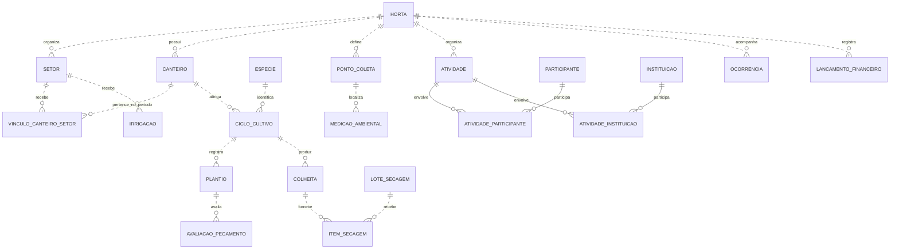

# Horta Comunitária FCT/UFG

Projeto de uma plataforma para apoiar o acompanhamento da Horta Comunitária da Faculdade de Ciências e Tecnologia da Universidade Federal de Goiás, no campus Aparecida de Goiânia, em parceria com o Instituto APOEMA.

A iniciativa aproxima produção agroecológica, sustentabilidade, ensino, pesquisa e extensão. A plataforma deverá organizar os registros da horta e transformar esses dados em informações úteis para a equipe e para as instituições participantes.

## Objetivos

- Reunir os dados da horta em um sistema integrado de coleta, armazenamento e gestão.
- Apresentar dashboards para acompanhar indicadores ambientais, produtivos, sociais, educacionais e econômicos, além dos registros operacionais que sustentam esse acompanhamento.

## Etapa atual

A interface atual se concentra no percurso horta → setor → canteiro, com navegação por contexto, cadastros guiados e dados organizados por nível. O menu mantém todos os módulos disponíveis. No canteiro, é possível cadastrar o que será cultivado e registrar o plantio com o contexto já preenchido. Usa React/TypeScript/Vite e Tailwind; o backend usa Minimal APIs, PostgreSQL e Serilog.

Consulte o [Get Started](documentos/Get_Started.md) para iniciar sem seed e testar pela interface. O [registro de execução do frontend](documentos/planejamento/Execucao_Frontend_MVP.md) descreve a integração e suas verificações. RF12 permanece adiado; RF01 permanece pós-MVP. Hipóteses funcionais e aceite da PO continuam pendentes.

Compostagem, integração com sensores e automação da irrigação ficam fora desta etapa.

O [planejamento do MVP](documentos/planejamento/mvp/README.md) divide os fluxos dos requisitos em entregas graduais. O [primeiro fluxo sugerido](documentos/planejamento/mvp-irrigacao/README.md) conecta irrigação manual, consulta, correção e consumo de água por setor em quatro etapas. Autenticação e autorização ficam para o pós-MVP.

Conforme o anexo de setembro de 2026, a horta ainda não foi implantada fisicamente. O desenho preliminar prevê 20 canteiros e cinco setores de irrigação, mas depende da aprovação da área e de validações técnicas. Essas quantidades são referências de planejamento e poderão mudar.

## Tecnologias previstas

- **Backend:** .NET 10 ou superior, ASP.NET Core e Entity Framework Core para acesso aos dados.
- **Frontend:** TypeScript, React, Vite e Tailwind CSS.
- **Banco de dados:** PostgreSQL.

O backend utiliza .NET 10, EF Core/Npgsql e logs estruturados com console legível em Development e JSON configurável. O frontend utiliza Tailwind como base visual, cliente Axios e TypeScript estrito. O [README do frontend](hortacomunitaria-webapp/README.md) descreve instalação, configuração e testes.

## Documentação

- [Contrato implementado do backend](documentos/arquitetura/Contrato_Backend_MVP.md): operações de criação/gestão, indicadores, conflitos e decisões de persistência.
- [Get Started](documentos/Get_Started.md): iniciar a aplicação, preparar um ambiente sem seed e testar as features disponíveis; lacunas em relação aos requisitos ficam explícitas.
- [Planejamento completo do frontend](documentos/planejamento/frontend/README.md): telas, criação/gestão, dependências, etapas e aceite de todos os requisitos atuais e nove indicadores.
- [Execução local da aplicação](documentos/arquitetura/Execucao_Local.md): configuração demonstrativa, migrations, API, frontend e testes.
- [Validação com a PO](documentos/planejamento/Validacao_PO_MVP_Irrigacao.md): roteiro de demonstração e decisões pendentes do primeiro fluxo.
- [Observabilidade](documentos/arquitetura/Observabilidade.md): estrutura dos eventos Serilog e correlação dos processos.
- [Documento técnico de requisitos](documentos/Documento_Tecnico_Requisitos_Horta.md): versão 0.0.1, com escopo e requisitos iniciais para validação com a PO.
- [Modelagem preliminar dos dados](documentos/arquitetura/Modelagem_Preliminar_Dados_Horta.md): entidades, informações principais e diagramas por domínio, sujeitos a validação.
- [Diagrama relacional geral](documentos/arquitetura/Diagrama_Relacional_Geral.md): visão da base prevista para os fluxos dos requisitos iniciais.
- [Planejamento dos fluxos](documentos/planejamento/Fluxos_Iniciais_Horta.md): sequência inicial de uso, dependências e pontos de validação com a PO.
- [Planos de implementação do MVP](documentos/planejamento/mvp/README.md): um documento por fluxo, com etapas, regras de negócio e critérios de aceite dos requisitos RF02–RF16.
- [Regras de arquitetura do backend](.codex/arquitetura-backend.md): referência de desenvolvimento para o Codex, vinculada pelo `AGENTS.md`.
- [Regras de arquitetura do frontend](.codex/arquitetura-frontend.mdc): organização React/TypeScript, integração HTTP e qualidade da interface, vinculadas pelo `AGENTS.md`.
- [Versão PDF](documentos/Documento_Tecnico_Requisitos_Horta.pdf): documento para leitura e compartilhamento.
- [Versão DOCX](documentos/Documento_Tecnico_Requisitos_Horta.docx): documento de requisitos editável para uso no Word e importação no Google Docs.
- [Dados e indicadores preliminares](documentos/Dados_e_Indicadores_Preliminares_Horta_APOEMA.pdf): principal referência para o levantamento atual.
- [Apresentação inicial do projeto](documentos/HORTA%20COMUNIT%C3%81RIA_.pdf): contexto da iniciativa e possibilidades de atuação conjunta.

Os documentos gerais ficam na raiz de `documentos`. A pasta `arquitetura` reúne os modelos e diagramas; `planejamento` reúne os fluxos e a organização das entregas. As instruções de desenvolvimento do Codex ficam em `.codex`.

## Visão básica da base de dados

A horta organiza canteiros, cultivos e registros de campo. As atividades reúnem participação e ações educacionais; os custos apoiam o acompanhamento econômico. Os dashboards utilizam esses registros como fonte.

Esta é uma visão resumida das relações principais. Cadastros auxiliares, permissões, documentos e relações opcionais estão detalhados na modelagem preliminar. Uma linha com `||` indica um registro de origem; `o{` indica zero ou vários registros relacionados.

## Construção colaborativa

Os requisitos e o modelo de dados são propostas para discussão com a coordenação da horta, a FCT/UFG e o APOEMA. As próximas revisões deverão validar os dados indispensáveis, as formas de coleta, os responsáveis e as regras de cálculo dos indicadores antes do uso operacional.

Os formulários serão voltados ao registro manual das informações disponíveis no início da operação.
