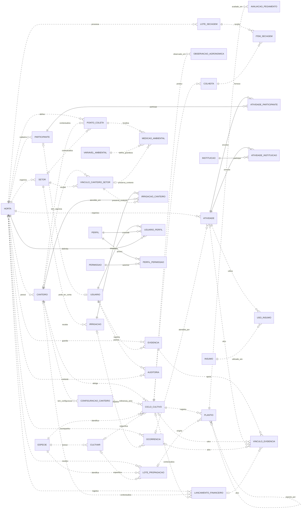

# Diagrama relacional geral da horta

Esta visão reúne as 37 entidades da [modelagem preliminar](Modelagem_Preliminar_Dados_Horta.md), cobrindo RF01–RF16. Os nomes são lógicos, não DDL PostgreSQL. As relações principais estão abaixo; campos, FKs opcionais de contexto e destinos de evidência estão nos [diagramas detalhados](Diagramas_Relacionais_Horta.md).

## Leitura e limites

- `||`: exatamente um; `o|`/`|o`: zero ou um; `o{`: zero ou muitos.
- Entidade repetida em outros diagramas é a mesma entidade. Associações tornam explícitas as relações N:N.
- FKs opcionais de contexto são alternativas sujeitas às regras de cada modelo; não representam obrigação de preencher todos os contextos.
- Evidências têm 15 tipos de destinos concretos previstos no diagrama detalhado, com exatamente um destino por vínculo.
- Autoria/validade dos fatos e responsáveis seguem as [convenções comuns](Modelagem_Preliminar_Dados_Horta.md). As arestas repetitivas dessas referências foram omitidas nesta visão geral.
- Auditoria identifica a chave do registro alterado como histórico; não cria uma FK polimórfica ou um novo registro produtivo.
- RF14 consulta os fatos. Dashboard e valor final de indicador não são entidades para digitação manual.

Não há implementação. Cardinalidades, campos indispensáveis e protocolos agronômicos continuam sujeitos à validação indicada nos modelos.
