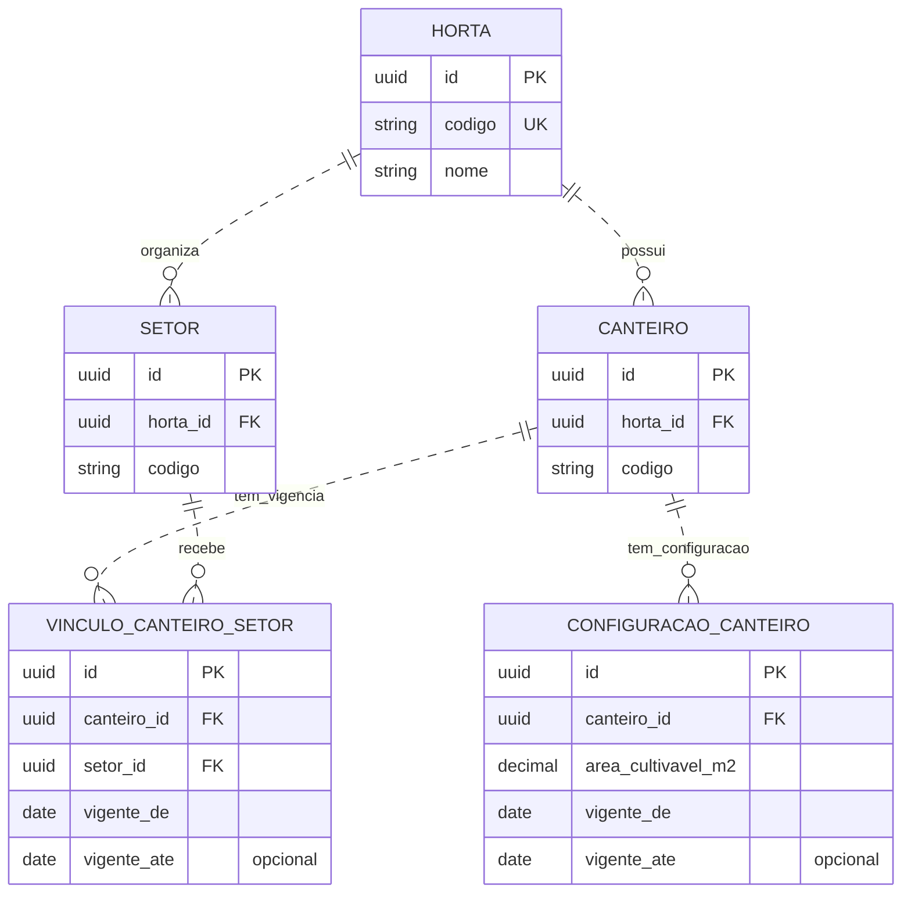
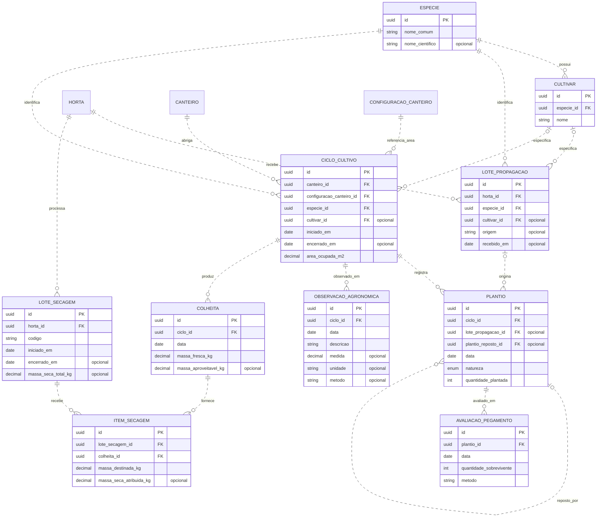
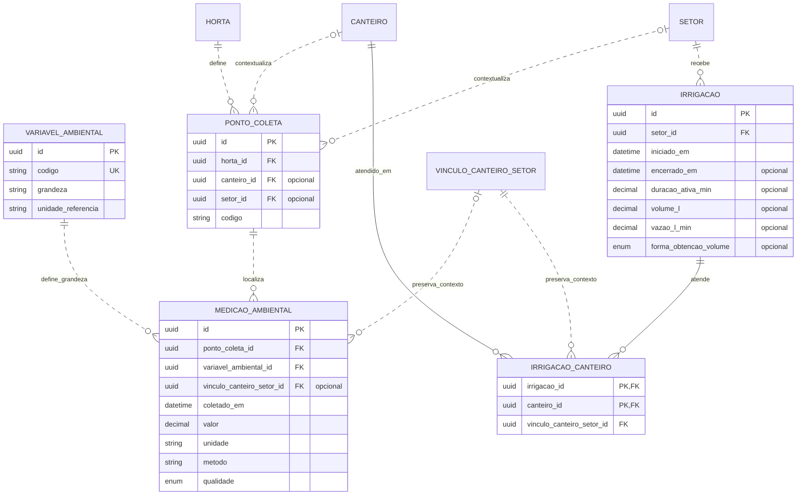
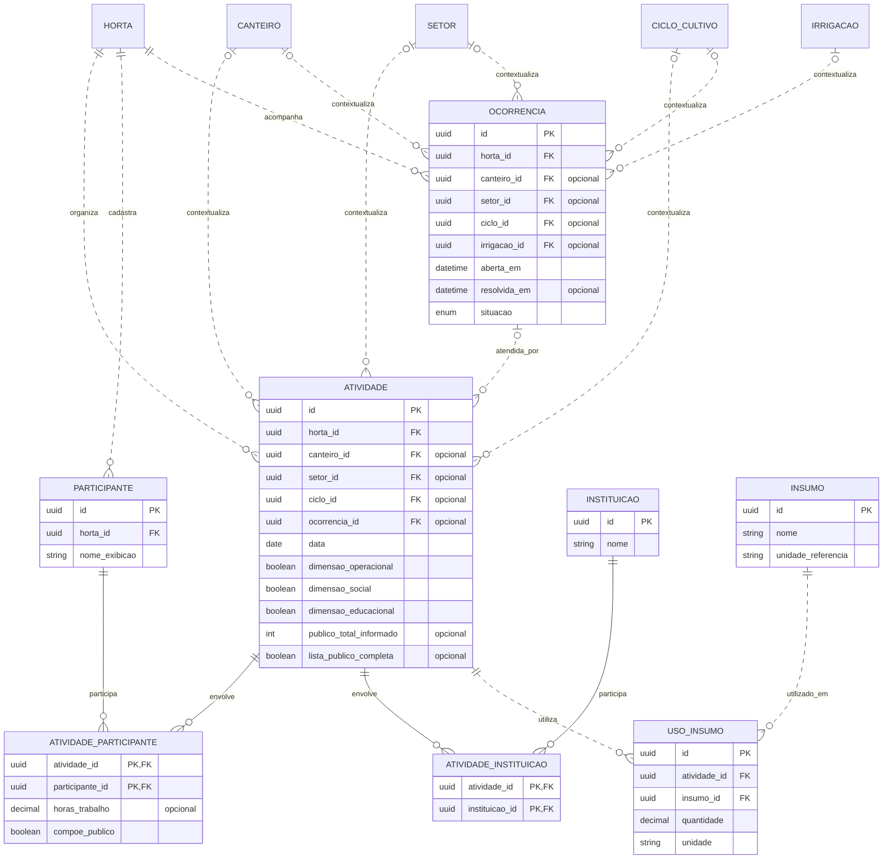
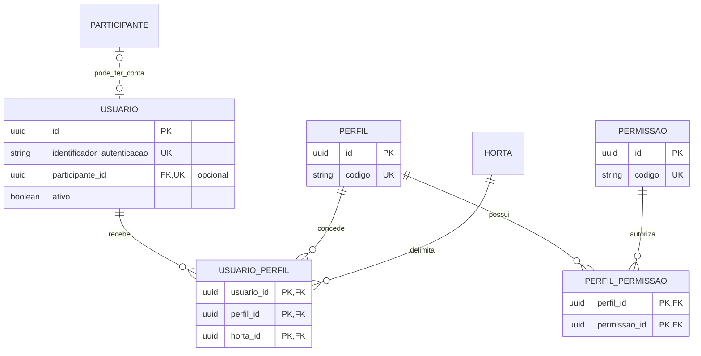
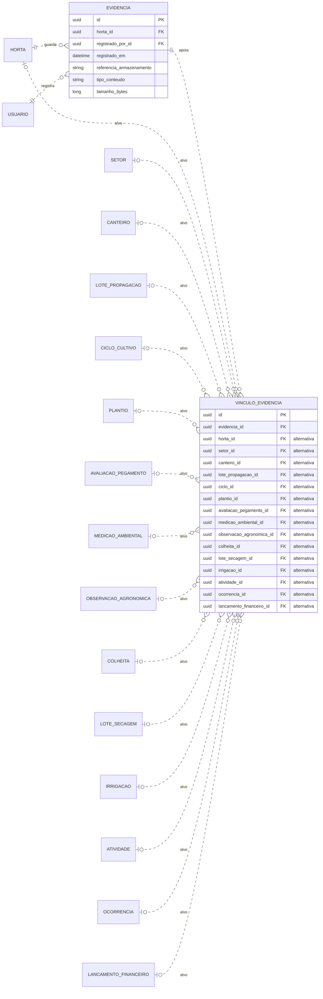
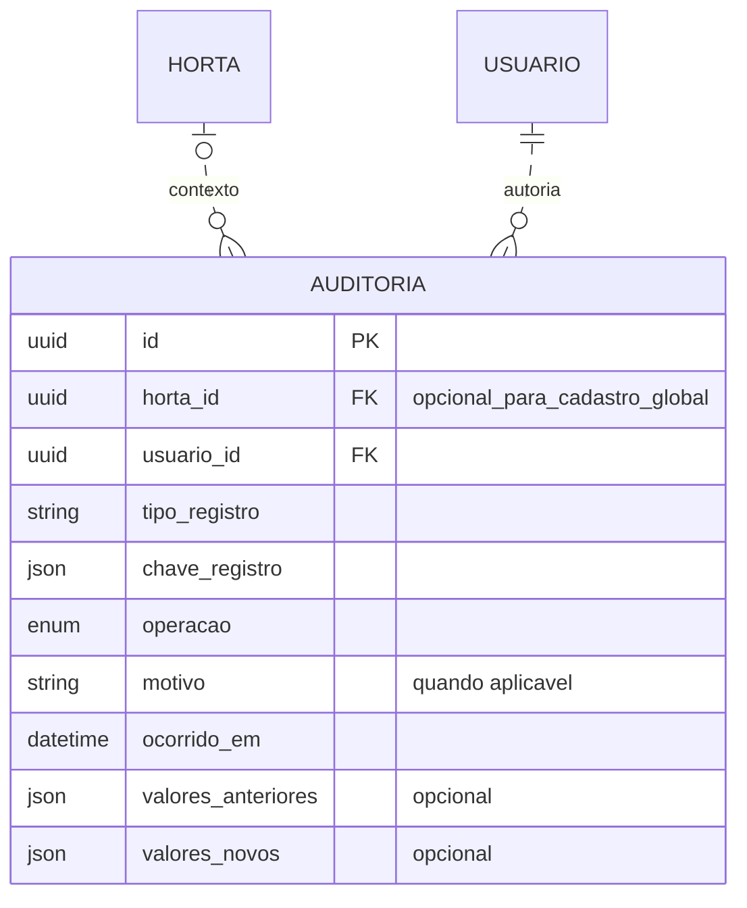
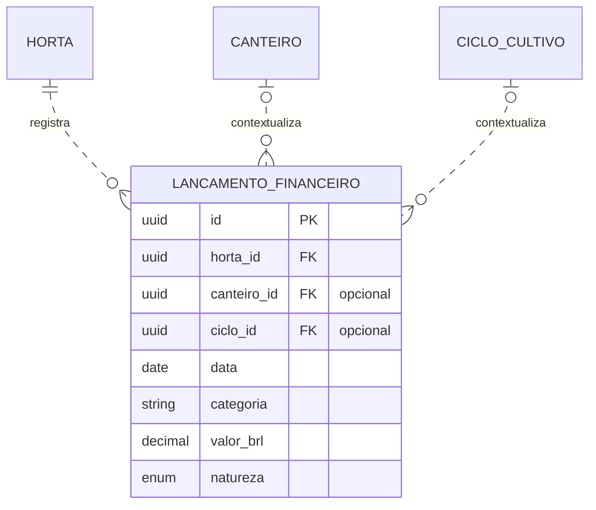

# Diagramas relacionais por domínio

Detalhamento da [modelagem preliminar](Modelagem_Preliminar_Dados_Horta.md), complementar ao [diagrama geral](Diagrama_Relacional_Geral.md). Cada bloco mostra chaves e campos essenciais à leitura das relações; os modelos de domínio contêm o restante do dicionário, as unidades e as regras.

`PK` indica chave primária; `FK`, referência; `UK`, unicidade individual. `||` é exatamente um, `o|`/`|o` zero ou um e `o{` zero ou muitos. PK composta contém todos os campos marcados `PK` na associação. Comentário “opcional” indica nulabilidade proposta. Nomes são lógicos; não são as colunas físicas da futura implementação.

Metadados comuns e FKs de responsável são descritos na [visão da modelagem](Modelagem_Preliminar_Dados_Horta.md), sem repeti-los em cada caixa/aresta. Cada `responsavel_participante_id` aponta para um participante da horta do fato; cada `registrado_por_id`, para seu usuário autor.

Linhas tracejadas (`..`) indicam relações que não compõem a PK do filho; linhas contínuas (`--`) são usadas nas associações cuja PK contém a referência ao pai. A notação segue a [documentação de diagramas ER do Mermaid](https://mermaid.js.org/syntax/entityRelationshipDiagram.html).

## Organização

**RF02.** Ver [modelo](Modelo_Organizacao_Horta.md).

Códigos de setor/canteiro são únicos no contexto da horta, não isoladamente. Vigências válidas não se sobrepõem para o mesmo canteiro, conforme a hipótese de um setor por data.

## Cultivo

**RF03–RF05, RF08 e RF09.** Ver [modelo](Modelo_Cultivo_Producao.md).

Proposta de unicidade do item: `(lote_secagem_id, colheita_id)`. Total seco do lote e atribuições de origem não são parcelas a somar juntas. A identidade dos pais é preservada ao corrigir dados.

## Ambiente

**RF06 e RF07.** Ver [modelo](Modelo_Ambiente_Irrigacao.md).

Ponto possui no máximo um contexto canteiro/setor. O vínculo histórico da medição só se aplica ao ponto de canteiro. Volume fica apenas em `IRRIGACAO`.

## Atividades

**RF10, RF11 e RF15.** Ver [modelo](Modelo_Atividades_Ocorrencias.md).

Contextos opcionais são alternativas. Vínculo com ocorrência é atendimento, não outro evento duplicado. Público informado inclui a parte nominal elegível; horas pertencem à associação individual.

## Acesso

**RF01.** Ver [modelo transversal](Modelo_Acesso_Historico_Evidencias.md).

## Evidências

**RF12.** Ver [modelo transversal](Modelo_Acesso_Historico_Evidencias.md).

Exatamente uma das 15 FKs de destino é preenchida por vínculo. Evidência e destino pertencem à mesma horta. A nulabilidade individual não permite vínculo sem alvo.

## Histórico

**RF13.** Ver [modelo transversal](Modelo_Acesso_Historico_Evidencias.md).

Tipo/chave identificam o alvo no histórico, inclusive chave composta; não são FK para uma entidade fictícia de registros. A operação e a auditoria são confirmadas juntas. Fatos da horta exigem contexto; identidade/catálogo global pode não tê-lo, com acesso administrativo específico.

## Custos

**RF16.** Ver [modelo](Modelo_Custos.md).

Canteiro e ciclo são alternativas de contexto, não campos a preencher juntos. Previsto/realizado são naturezas diferentes. RF14 usa essas entidades e os demais fatos conforme [Dados dos indicadores](Dados_Indicadores.md), sem tabela de valores finais de dashboard.
