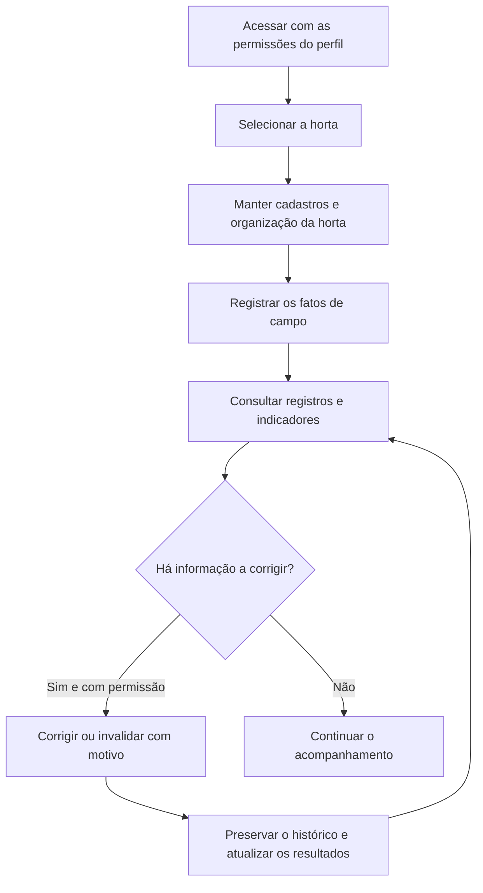

# Planejamento dos fluxos da horta

Este documento organiza os fluxos iniciais de uso com base nos [requisitos da versão 0.0.1](../Documento_Tecnico_Requisitos_Horta.md). É uma proposta para discussão com a PO, restrita à gestão dos registros manuais e aos dashboards. Não acrescenta funcionalidades nem aprova campos, fórmulas ou permissões.

Os dados de cada fluxo estão nos [modelos por domínio](../arquitetura/Modelagem_Preliminar_Dados_Horta.md); suas relações aparecem no [diagrama geral](../arquitetura/Diagrama_Relacional_Geral.md) e nos [diagramas detalhados](../arquitetura/Diagramas_Relacionais_Horta.md).

Esta é a visão funcional geral. A sequência executável está no [planejamento dos fluxos do MVP](mvp/README.md), começando pelo [plano de irrigação](mvp-irrigacao/README.md); esses planos substituem a ordem genérica abaixo para essa entrega. Por decisão do responsável pelo projeto, autenticação e autorização serão tratadas no pós-MVP; os passos de acesso deste documento representam o produto futuro.

## Fluxo geral

## Fluxos e dependências

| Fluxo | Sequência inicial | Referências |
| --- | --- | --- |
| Preparação | Definir acessos, cadastrar horta, setores, canteiros e espécies; registrar a origem do material quando conhecida | RF01–RF03 |
| Cultivo | Abrir ciclo, registrar plantio ou replantio, avaliar pegamento e acompanhar observações agronômicas | RF04, RF05, RF08 |
| Condições ambientais e irrigação | Selecionar o local/contexto, informar a coleta ou irrigação manual e consultar os registros do período | RF06, RF07 |
| Produção | Registrar colheita e perdas conhecidas; quando houver secagem, vincular a massa destinada e informar o resultado disponível | RF09 |
| Atividades e ocorrências | Registrar atividade, participantes, esforço e insumos; registrar ocorrências e providências quando necessárias | RF10, RF11 |
| Evidências | Associar documento ou fotografia a um registro e consultá-lo conforme as permissões | RF12 |
| Acompanhamento | Escolher período e filtros, consultar indicadores e conferir os registros de origem | RF13, RF14 |
| Dimensões complementares | Classificar ações sociais/educacionais e registrar custos básicos conforme a prioridade acordada | RF15, RF16 |

Cadastros fornecem o contexto dos registros; registros fornecem os dados dos indicadores. Cada fluxo usa apenas os vínculos necessários ao seu caso de uso. Uma atividade, coleta ou ocorrência não exige a execução de todo o fluxo de cultivo.

## Consulta e correção

1. Filtrar os registros e abrir o detalhe.
2. Conferir os dados e as evidências disponíveis.
3. Com permissão, corrigir ou invalidar a informação, registrando o motivo.
4. Preservar autoria, data e informação anterior no histórico.
5. Refletir a correção nos indicadores; registros invalidados deixam de compor os resultados.

Sem dados ou com informação insuficiente, o dashboard apresenta a situação correspondente, sem transformar ausência de coleta em zero.

## Ordem inicial de detalhamento

1. Validar com a PO os cadastros indispensáveis e as permissões de cada perfil.
2. Detalhar os formulários dos registros que alimentam os nove indicadores prioritários.
3. Validar fórmulas, unidades, períodos e filtros dos dashboards, com exemplos de dados.
4. Confirmar consulta, correção, histórico e vínculo de evidências.
5. Acordar a inclusão dos registros sociais, educacionais e econômicos básicos.

A ordem orienta o planejamento, sem definir prazos ou autorizar o início da implementação. Sensores, automação da irrigação e compostagem permanecem fora desta etapa.
